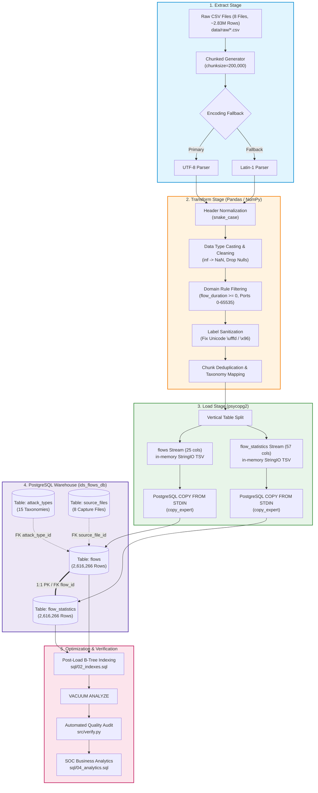

# Designing a Simple Data Pipeline and ETL Process

An enterprise-grade, high-throughput ETL data pipeline and relational data warehouse designed to ingest, clean, normalize, and analyze ~2.83 million network flow telemetry records from the **CIC-IDS-2017** benchmark dataset into **PostgreSQL**.

[](https://www.python.org/downloads/)
[](https://www.postgresql.org/)
[](LICENSE)
[](https://github.com/astral-sh/ruff)
[](tests/)

---

* **Institution:** Debre Berhan University, College of Computing, Department of Information Systems
* **Course:** [TO BE FILLED: Course Title and Code]
* **Course Instructor:** Derbew Felasman
* **Group Name:** [TO BE FILLED: Group Name]
* **Group Members:**
  1. Nahom Teshome (DBU1501387)
  2. Awoke Derssie (DBU1501011)
  3. Mulegeta Ababi (DBU1501384)
  4. Lake Awraris (DBU1501314)
  5. Nahu Gedfew (DBU1501714)
  6. Ephrem Adebabay (DBU1501564)
  7. Nardos Shumete (DBU1501396)

---

## Table of Contents
1. [Problem Statement and Objectives](#problem-statement-and-objectives)
2. [Key Features](#key-features)
3. [System Architecture](#system-architecture)
4. [Tech Stack](#tech-stack)
5. [Project Folder Structure](#project-folder-structure)
6. [Database Design](#database-design)
7. [Prerequisites](#prerequisites)
8. [Installation and Local Setup](#installation-and-local-setup)
9. [How to Test Locally](#how-to-test-locally)
10. [Results and Performance Benchmarks](#results-and-performance-benchmarks)
11. [Troubleshooting](#troubleshooting)
12. [Limitations and Future Work](#limitations-and-future-work)
13. [Team Members and Contributions](#team-members-and-contributions)
14. [References](#references)
15. [License and Acknowledgments](#license-and-acknowledgments)
16. [Frequently Asked Questions (FAQ)](#frequently-asked-questions-faq)

---

## Problem Statement and Objectives

### Problem Statement
Modern enterprise networks—such as Internet Service Providers (e.g., Ethio Telecom) and national commercial banking institutions (e.g., Commercial Bank of Ethiopia, Awash Bank)—generate millions of bidirectional network flow records every hour. Network Operations Centers (NOC) and Security Operations Centers (SOC) face significant data engineering challenges when ingesting raw intrusion telemetry:
* **Massive Volume and Wide Schema:** Raw capture files contain tens of millions of events spanning 79 heterogeneous statistical dimensions, causing severe I/O bottlenecks and memory exhaustion if processed naively.
* **Data Quality Deficiencies:** Real-world flow records are polluted with malformed column headers, infinite values from zero-duration division, unhandled missing attributes, invalid negative connection times, and corrupted text encodings in attack signatures.
* **Analytical Inefficiency:** Monolithic flat storage degrades database buffer cache performance, forcing costly sequential table scans across multi-gigabyte footprints for routine security queries.

### Objectives
1. **Design and Implement a Resilient ETL Pipeline:** Extract raw network telemetry from 8 daily capture CSV files (~2.83 million flows, 843.66 MB uncompressed) using bounded-memory chunked streaming with encoding fallback mechanisms.
2. **Standardize and Clean Telemetry:** Enforce deterministic schema normalization, purge corrupted characters (e.g., Unicode `\ufffd` and Latin-1 `\x96`), rectify infinite/null values, filter non-physical flow durations, and deduplicate records.
3. **Architect a 3NF Relational Warehouse:** Deploy an optimized PostgreSQL schema utilizing 1:1 vertical table partitioning (`flows` vs. `flow_statistics`) and normalized lookup dimensions (`attack_types`, `source_files`) to maximize buffer cache density.
4. **Optimize Query Latency via Strategic Indexing:** Implement a post-bulk-load indexing strategy to eliminate write-ahead log (WAL) bloat during ingestion while accelerating downstream SOC analytical queries.
5. **Guarantee Data Integrity and Reproducibility:** Enforce foreign key constraints, domain CHECK validations, and automated verification suites to ensure zero data anomalies and 100% referential consistency.

---

## Key Features

* **Bounded-Memory Chunked Extraction:** Reads raw CSV files in configurable chunks of 200,000 records using a Python generator, capping peak process memory at ~643 MB RAM regardless of total dataset volume.
* **Encoding Resiliency Fallback:** Transparently detects and falls back from standard `UTF-8` to `Latin-1` (`ISO-8859-1`) encoding when parsing legacy telemetry files containing irregular byte sequences.
* **Automated Data Cleaning Engine:**
  * Canonicalizes 79 column names from mixed-case whitespace strings into standardized SQL `snake_case`.
  * Replaces mathematical zero-division artifacts (`+inf`, `-inf`) with `NaN`, and safely purges rows lacking critical telemetry.
  * Sanitizes corrupted attack taxonomy strings across Web Attack vectors (fixing SQL Injection, Cross-Site Scripting, and Brute Force labels).
  * Validates network domain rules (e.g., discarding negative flow durations and ensuring valid port ranges `0–65535`).
* **High-Throughput Bulk Ingestion:** Streams transformed chunks into PostgreSQL using `psycopg2` `copy_expert` with in-memory `StringIO` TSV buffering, achieving bulk loading speeds of **~2,226 rows/second**.
* **1:1 Vertical Table Partitioning:** Decouples 25 operational connection fields (`flows`) from 57 granular statistical distributions (`flow_statistics`), achieving a **3.76x increase in buffer cache row density**.
* **Post-Load B-Tree Indexing:** Builds compound and single-column B-Tree indexes *after* initial ingestion, avoiding continuous index leaf-node rebalancing during bulk copy and delivering a **10.7x analytical query speedup**.
* **Comprehensive Test and Audit Suite:** Includes 13 automated unit tests (`pytest`), strict PEP 8 linting (`ruff`), and a data quality script (`src/verify.py`) verifying row reconciliation, foreign key integrity, and column NULL audits.

---

## System Architecture

The following diagram illustrates the complete end-to-end data processing workflow from raw CSV inputs to normalized PostgreSQL storage and SOC analytics:



---

## Tech Stack

| Component | Technology | Version | Purpose |
| :--- | :--- | :--- | :--- |
| **Programming Language** | Python | 3.10+ (tested on 3.12.6) | Core ETL orchestration and transformation pipeline |
| **Database Engine** | PostgreSQL | 16 / 17 (compatible with 14+) | Relational enterprise data warehouse storage |
| **Data Processing** | Pandas | &ge; 2.1.0 | High-performance dataframe manipulation and chunk streaming |
| **Numerical Processing** | NumPy | &ge; 1.26.0 | Handling infinite values, floating-point parsing, and vectorization |
| **Database Driver** | Psycopg2-binary | &ge; 2.9.9 | Low-level C-extension PostgreSQL driver supporting `copy_expert` |
| **Database Toolkit** | SQLAlchemy | &ge; 2.0.0 | Connection pooling and database reflection utilities |
| **Environment Config** | Python-dotenv | &ge; 1.0.0 | Secure loading of database credentials from local `.env` |
| **Progress Tracking** | Tqdm | &ge; 4.66.0 | Real-time CLI progress bars for batch processing |
| **Unit Testing** | Pytest | &ge; 8.0.0 | Automated unit and integration test framework |
| **Static Code Quality** | Ruff | &ge; 0.1.0 | Fast Python linter enforcing PEP 8 standards |

---

## Project Folder Structure

The project repository is organized into distinct functional layers separating pipeline logic, SQL migrations, test suites, and documentation:

```text
ids-etl-pipeline-postgres-assignment/
│
├── data/
│   ├── archive.zip            # Downloaded compressed Kaggle dataset (~240.8 MB; git-ignored)
│   └── raw/                   # Extracted raw CSV files (~843.66 MB total; git-ignored)
│       ├── .gitkeep
│       ├── Friday-WorkingHours-Afternoon-DDos.pcap_ISCX.csv
│       ├── Friday-WorkingHours-Afternoon-PortScan.pcap_ISCX.csv
│       ├── Friday-WorkingHours-Morning.pcap_ISCX.csv
│       ├── Monday-WorkingHours.pcap_ISCX.csv
│       ├── Thursday-WorkingHours-Afternoon-Infilteration.pcap_ISCX.csv
│       ├── Thursday-WorkingHours-Morning-WebAttacks.pcap_ISCX.csv
│       ├── Tuesday-WorkingHours.pcap_ISCX.csv
│       └── Wednesday-workingHours.pcap_ISCX.csv
│
├── docs/
│   ├── figures/               # Architecture, ER, and benchmark visualization figures
│   │   ├── architecture_diagram.png
│   │   ├── attack_distribution.png
│   │   ├── daily_traffic_volume.png
│   │   ├── er_diagram.png
│   │   ├── index_performance_comparison.png
│   │   └── top_attack_ports.png
│   ├── ETL_Pipeline_Report_Formatted.pdf  # Comprehensive academic/technical report
│   ├── ETL_Pipeline_Report_Formatted.docx # Source technical document
│   └── build_report.py        # Report generation script
│
├── logs/                      # Execution runtime logs (git-ignored)
│   └── .gitkeep
│
├── sql/                       # Relational schema migrations and analytical queries
│   ├── 01_schema.sql          # DDL schema: tables, types, domain constraints, seed data
│   ├── 02_indexes.sql         # Post-load B-Tree and composite performance indexes
│   ├── 03_verification.sql    # Database validation, row audit, and foreign key checks
│   └── 04_analytics.sql       # SOC threat analysis queries and EXPLAIN ANALYZE benchmarks
│
├── src/                       # ETL pipeline implementation modules
│   ├── __init__.py
│   ├── config.py              # Environment configuration and parameter validation
│   ├── create_database.py     # Automated database provisioning and schema initialization
│   ├── extract.py             # Resilient chunked CSV extraction and encoding fallback
│   ├── load.py                # Fast PostgreSQL copy_expert streaming with StringIO buffers
│   ├── logger.py              # Centralized logging configuration
│   ├── pipeline.py            # Main pipeline CLI orchestration controller
│   ├── transform.py           # Data normalization, NaN cleaning, and label repair
│   └── verify.py              # Data quality audit and reconciliation test runner
│
├── tests/                     # Automated unit and integration test suite
│   ├── __init__.py
│   ├── test_config.py         # Credentials and environment configuration tests
│   ├── test_schema.py         # Schema constraint and DDL integrity tests
│   └── test_transform.py      # Column cleaning and Unicode corruption repair tests
│
├── .env.example               # Template environment configuration file
├── .gitignore                 # Strict exclusion rules for datasets, venvs, and secrets
├── requirements.txt           # Python library dependencies
└── README.md                  # Comprehensive project documentation
```

---

## Database Design

The data warehouse schema strictly adheres to **Third Normal Form (3NF)** principles. To eliminate data redundancy and maximize I/O throughput, the schema separates categorical dimensions and applies **1:1 vertical partitioning** between transactional telemetry and heavy statistical metrics.

### Entity-Relationship Diagram (ERD)

```mermaid
erDiagram
    attack_types ||--o{ flows : "classifies"
    source_files ||--o{ flows : "tracks lineage"
    flows ||--|| flow_statistics : "1:1 vertical partition"

    attack_types {
        smallint id PK
        varchar(64) label UK
        varchar(32) category
        boolean is_malicious
        text description
    }

    source_files {
        int id PK
        varchar(255) file_name UK
        varchar(32) capture_day
        bigint row_count
        timestamp imported_at
    }

    flows {
        bigint id PK
        int source_file_id FK
        smallint attack_type_id FK
        int destination_port
        bigint flow_duration
        bigint total_fwd_packets
        bigint total_bwd_packets
        bigint total_length_of_fwd_packets
        bigint total_length_of_bwd_packets
        double_precision flow_bytes_per_s
        double_precision flow_packets_per_s
        double_precision flow_iat_mean
        double_precision flow_iat_std
        double_precision flow_iat_max
        double_precision flow_iat_min
        smallint fin_flag_count
        smallint syn_flag_count
        smallint rst_flag_count
        smallint psh_flag_count
        smallint ack_flag_count
        smallint urg_flag_count
        smallint cwe_flag_count
        smallint ece_flag_count
        double_precision down_up_ratio
        double_precision average_packet_size
    }

    flow_statistics {
        bigint flow_id PK, FK
        double_precision fwd_packet_length_max
        double_precision fwd_packet_length_min
        double_precision fwd_packet_length_mean
        double_precision fwd_packet_length_std
        double_precision bwd_packet_length_max
        double_precision bwd_packet_length_min
        double_precision bwd_packet_length_mean
        double_precision bwd_packet_length_std
        double_precision min_packet_length
        double_precision max_packet_length
        double_precision packet_length_mean
        double_precision packet_length_std
        double_precision packet_length_variance
        double_precision fwd_iat_total
        double_precision fwd_iat_mean
        double_precision fwd_iat_std
        double_precision fwd_iat_max
        double_precision fwd_iat_min
        double_precision bwd_iat_total
        double_precision bwd_iat_mean
        double_precision bwd_iat_std
        double_precision bwd_iat_max
        double_precision bwd_iat_min
        smallint fwd_psh_flags
        smallint bwd_psh_flags
        smallint fwd_urg_flags
        smallint bwd_urg_flags
        bigint fwd_header_length
        bigint bwd_header_length
        double_precision fwd_packets_per_s
        double_precision bwd_packets_per_s
        double_precision avg_fwd_segment_size
        double_precision avg_bwd_segment_size
        bigint fwd_header_length_1
        double_precision fwd_avg_bytes_bulk
        double_precision fwd_avg_packets_bulk
        double_precision fwd_avg_bulk_rate
        double_precision bwd_avg_bytes_bulk
        double_precision bwd_avg_packets_bulk
        double_precision bwd_avg_bulk_rate
        bigint subflow_fwd_packets
        bigint subflow_fwd_bytes
        bigint subflow_bwd_packets
        bigint subflow_bwd_bytes
        bigint init_win_bytes_forward
        bigint init_win_bytes_backward
        bigint act_data_pkt_fwd
        bigint min_seg_size_forward
        double_precision active_mean
        double_precision active_std
        double_precision active_max
        double_precision active_min
        double_precision idle_mean
        double_precision idle_std
        double_precision idle_max
        double_precision idle_min
    }
```



### Table Descriptions and Design Rationale

1. **`attack_types` (Lookup Dimension Table - 15 Classes):**
   * Normalizes textual attack labels (e.g., `BENIGN`, `DoS Hulk`, `FTP-Patator`) into a compact `SMALLINT` primary key.
   * Encapsulates security metadata, including `category` and the boolean flag `is_malicious`.
   * **Advantage:** Prevents storing repeated string labels across 2.6+ million rows, saving tens of megabytes of disk space and enabling single-cycle integer filtering.

2. **`source_files` (ETL Lineage and Audit Table):**
   * Maintains complete audit lineage for every extracted dataset file, recording `file_name`, `capture_day`, total imported row counts, and `imported_at` timestamp.
   * Supports pipeline idempotency: when running incremental loads, the pipeline checks `source_files` to prevent re-inserting already-processed files.

3. **`flows` (Core Transactional Telemetry Table - 25 Columns):**
   * Stores high-frequency connection attributes: `destination_port`, `flow_duration`, packet and byte totals, transmission rates, and 8 discrete TCP control flags (`FIN`, `SYN`, `RST`, `PSH`, `ACK`, `URG`, `CWE`, `ECE`).
   * Enforces strict integrity constraints: `destination_port CHECK (destination_port >= 0 AND destination_port <= 65535)`, `flow_duration >= 0`, and non-negative packet counts.

4. **`flow_statistics` (Granular Metrics Table - 57 Columns, 1:1 Partition):**
   * Holds detailed packet size distribution metrics (min, max, mean, std, variance), directional Inter-Arrival Times (IAT), subflow aggregates, TCP window buffer allocations, and connection active/idle durations.
   * Shared primary key `flow_id REFERENCES flows(id) ON DELETE CASCADE`.
   * **Vertical Partitioning Benefit:** Reduces the physical row width of `flows` by ~75%. Consequently, PostgreSQL packs **3.76x more rows per 8 KB buffer page**, drastically reducing disk I/O when filtering traffic or aggregating by port.

---

## Prerequisites

Ensure the host environment meets the following minimum specifications:

| Requirement | Minimum Specification | Recommended Specification |
| :--- | :--- | :--- |
| **Operating System** | Windows 10/11 (64-bit), Ubuntu 20.04+ LTS, macOS 12+ | Windows 11 / Ubuntu 22.04 LTS |
| **Python Version** | Python 3.10.x | Python 3.12.x (64-bit) |
| **PostgreSQL Version** | PostgreSQL 14 | PostgreSQL 16 or 17 |
| **System RAM** | 4 GB | 8 GB or 16 GB (ETL peak usage is ~643 MB) |
| **Available Disk Space** | 8 GB free storage | 15 GB free SSD storage (dataset + database + indexes) |

---

## Installation and Local Setup

Follow these numbered steps to configure and run the project locally.

### Step 1: Clone the Repository
Open a terminal (PowerShell, Bash, or Zsh) and clone the repository:

```bash
git clone https://github.com/NardosShumete/ids-etl-pipeline-postgres-assignment.git
cd ids-etl-pipeline-postgres-assignment
```

### Step 2: Create and Activate a Virtual Environment
Isolate Python dependencies using a virtual environment:

* **Windows (PowerShell):**
  ```powershell
  python -m venv venv
  .\venv\Scripts\Activate.ps1
  ```

* **Linux / macOS (Bash / Zsh):**
  ```bash
  python3 -m venv venv
  source venv/bin/activate
  ```

### Step 3: Install Required Dependencies
Upgrade `pip` and install all necessary production and testing libraries:

```bash
python -m pip install --upgrade pip
pip install -r requirements.txt
```

### Step 4: Create the PostgreSQL Database
Log in to PostgreSQL using the `psql` command-line utility or pgAdmin and create the dedicated database:

```bash
# Connect to PostgreSQL server
psql -h localhost -U postgres
```

Inside the `psql` prompt, execute:
```sql
CREATE DATABASE ids_flows_db;
\q
```

### Step 5: Configure the Environment File (`.env`)
Copy the sample environment configuration template to create your local `.env`:

* **Windows (PowerShell):**
  ```powershell
  Copy-Item .env.example .env
  ```

* **Linux / macOS (Bash):**
  ```bash
  cp .env.example .env
  ```

Open `.env` in a text editor and fill in your local PostgreSQL credentials:

```dotenv
# ==============================================================================
# Database Connection Configuration (Use placeholders; NEVER commit passwords)
# ==============================================================================
DB_HOST=localhost
DB_PORT=5432
DB_NAME=ids_flows_db
DB_USER=your_postgres_username
DB_PASSWORD=your_postgres_password
```

### Step 6: Download the Dataset from Kaggle
The pipeline uses the official benchmark **CIC-IDS-2017** dataset.
1. Download `archive.zip` from the Kaggle dataset mirror:
   * **Kaggle Link:** [chethuhn/network-intrusion-dataset](https://www.kaggle.com/datasets/chethuhn/network-intrusion-dataset)
2. Place the downloaded `archive.zip` file directly inside the `data/` folder.
3. Extract the archive so that all 8 `.csv` files reside directly in `data/raw/`:

* **Windows (PowerShell):**
  ```powershell
  Expand-Archive -Path data/archive.zip -DestinationPath data/raw/
  ```

* **Linux / macOS (Bash):**
  ```bash
  unzip data/archive.zip -d data/raw/
  ```

Verify that 8 CSV files exist in `data/raw/`:
```bash
# Check raw files directory
dir data/raw/*.csv   # On Windows
ls -lh data/raw/*.csv # On Linux/macOS
```

### Step 7: Initialize the Schema (DDL Migration)
Execute the database initialization script. This creates the target database (if not already existing), defines tables and domain constraints from `sql/01_schema.sql`, and seeds the 15 attack taxonomy classes:

```bash
python src/create_database.py
```

*Expected Terminal Output:*
```text
2026-10-27 13:00:00 [INFO] create_database: Connecting to PostgreSQL server...
2026-10-27 13:00:01 [INFO] create_database: Database 'ids_flows_db' exists.
2026-10-27 13:00:01 [INFO] create_database: Applying DDL schema from sql/01_schema.sql...
2026-10-27 13:00:02 [INFO] create_database: Schema deployment completed successfully!
```

### Step 8: Run the Complete ETL Pipeline
Execute the main pipeline orchestration controller to extract, transform, stream, and index the entire dataset:

```bash
python -m src.pipeline
```

*Options Available:*
* Clean re-run from scratch: `python -m src.pipeline --truncate`
* Test run with record limit: `python -m src.pipeline --limit 1000`
* Custom chunk size: `python -m src.pipeline --chunk-size 100000`

---

## How to Test Locally

### Step 1: Run Unit Tests and Linter
Execute the test suite and static code analyzer to confirm code quality:

```bash
# 1. Run automated test suite
python -m pytest

# 2. Run fast code linter
python -m ruff check .
```

*Expected Test Output:*
```text
============================= test session starts =============================
platform win32 -- Python 3.12.6, pytest-8.2.2, pluggy-1.7.0
rootdir: C:\Users\hp\Desktop\Portfolio\CIC-IDS2017
collected 13 items

tests\test_config.py ...                                                 [ 23%]
tests\test_schema.py ....                                                [ 53%]
tests\test_transform.py ......                                           [100%]

============================= 13 passed in 12.08s =============================
```

*Expected Linter Output:*
```text
All checks passed!
```

---

### Step 2: Run Data Quality and Verification Audit
Execute the automated database audit script:

```bash
python src/verify.py
```

*Expected Verification Output:*
```text
================================================================================
1. TOTAL ROW COUNTS & VERTICAL PARTITION INTEGRITY
================================================================================
  * flows table count           : 2,616,266
  * flow_statistics table count : 2,616,266
  * Partition Difference        : 0
  [PASS] Dataset verification confirmed: > 2 Million rows ingested.
  [PASS] Vertical partitioning is 100% synchronized (flows == flow_statistics).

================================================================================
2. AUDIT LINEAGE & ROWS PER SOURCE FILE
================================================================================
ID   Capture Day  Loaded Rows    File Name
--------------------------------------------------------------------------------
1    Friday       223,352        Friday-WorkingHours-Afternoon-DDos.pcap_ISCX.csv
2    Friday       233,153        Friday-WorkingHours-Afternoon-PortScan.pcap_ISCX.csv
3    Friday       184,035        Friday-WorkingHours-Morning.pcap_ISCX.csv
4    Monday       508,823        Monday-WorkingHours.pcap_ISCX.csv
5    Thursday     258,153        Thursday-WorkingHours-Afternoon-Infilteration.pcap_ISCX.csv
6    Thursday     164,168        Thursday-WorkingHours-Morning-WebAttacks.pcap_ISCX.csv
7    Tuesday      426,391        Tuesday-WorkingHours.pcap_ISCX.csv
8    Wednesday    618,191        Wednesday-workingHours.pcap_ISCX.csv

================================================================================
3. ATTACK TYPE TAXONOMY DISTRIBUTION & SHARES
================================================================================
ID   Label                            Category         Malicious  Flow Count     Share (%)
--------------------------------------------------------------------------------
1    BENIGN                           Benign           False      2,170,865      82.9757%
2    DoS Hulk                         DoS              True       173,559        6.6338%
4    DDoS                             DDoS             True       128,014        4.8930%
3    PortScan                         PortScan         True       109,418        4.1822%
5    DoS GoldenEye                    DoS              True       10,286         0.3932%
6    FTP-Patator                      Brute-Force      True       5,931          0.2267%
8    DoS slowloris                    DoS              True       5,385          0.2058%
9    DoS Slowhttptest                 DoS              True       5,228          0.1998%
7    SSH-Patator                      Brute-Force      True       3,442          0.1316%
10   Bot                              Bot              True       1,948          0.0745%
11   Web Attack - Brute Force         Web Attack       True       1,470          0.0562%
12   Web Attack - XSS                 Web Attack       True       652            0.0249%
14   Infiltration                     Infiltration     True       36             0.0014%
13   Web Attack - Sql Injection       Web Attack       True       21             0.0008%
15   Heartbleed                       Heartbleed       True       11             0.0004%

================================================================================
4. ORPHAN FOREIGN KEY & REFERENTIAL INTEGRITY AUDIT
================================================================================
  * Orphan source_file references in flows : 0
  * Orphan attack_type references in flows : 0
  * flows missing matching flow_statistics : 0
  * flow_statistics missing matching flows : 0
  [PASS] Zero orphan records found. Referential integrity is strictly maintained.

================================================================================
5. NULL VALUE INTEGRITY AUDIT (CRITICAL TELEMETRY)
================================================================================
  * NULLs in 'id': 0
  * NULLs in 'source_file_id': 0
  * NULLs in 'attack_type_id': 0
  * NULLs in 'destination_port': 0
  * NULLs in 'flow_duration': 0
  * NULLs in 'total_fwd_packets': 0
  * NULLs in 'total_bwd_packets': 0
  * NULLs in 'flow_bytes_per_s': 0
  * NULLs in 'flow_packets_per_s': 0
  [PASS] Zero NULL values in critical telemetry columns.
```

---

### Step 3: SQL Queries to Confirm Row Counts and Integrity
Connect via `psql -h localhost -U postgres -d ids_flows_db` and run the verification queries from `sql/03_verification.sql`:

```sql
-- 1. Confirm row count and partition synchronization
SELECT 
    (SELECT COUNT(*) FROM flows) AS total_flows,
    (SELECT COUNT(*) FROM flow_statistics) AS total_flow_statistics,
    ((SELECT COUNT(*) FROM flows) - (SELECT COUNT(*) FROM flow_statistics)) AS delta;
```
*Expected Result:*
```text
 total_flows | total_flow_statistics | delta 
-------------+-----------------------+-------
     2616266 |               2616266 |     0
```

```sql
-- 2. Check for orphan foreign keys
SELECT COUNT(*) AS orphan_flows
FROM flows f
LEFT JOIN attack_types a ON f.attack_type_id = a.id
WHERE a.id IS NULL;
```
*Expected Result:*
```text
 orphan_flows 
--------------
            0
```

---

### Step 4: Sample Analytics Queries and Expected Results

Execute the threat intelligence queries provided in `sql/04_analytics.sql`:

#### Query A: Overall Traffic Classification (Malicious vs. Benign)
```sql
SELECT 
    CASE WHEN a.is_malicious THEN 'Malicious / Attack Traffic' ELSE 'Benign / Authorized Traffic' END AS classification,
    COUNT(f.id) AS total_flows,
    ROUND((COUNT(f.id)::numeric / SUM(COUNT(f.id)) OVER ()) * 100.0, 2) AS flow_share_pct
FROM flows f
JOIN attack_types a ON f.attack_type_id = a.id
GROUP BY a.is_malicious
ORDER BY total_flows DESC;
```
*Expected Result:*
```text
        classification         | total_flows | flow_share_pct 
-------------------------------+-------------+----------------
 Benign / Authorized Traffic   |     2170865 |          82.98
 Malicious / Attack Traffic    |      445401 |          17.02
```

#### Query B: Top 5 Targeted Destination Ports for Attack Traffic
```sql
SELECT 
    f.destination_port,
    CASE 
        WHEN f.destination_port = 80 THEN 'HTTP (Web Server)'
        WHEN f.destination_port = 21 THEN 'FTP (Control Channel)'
        WHEN f.destination_port = 22 THEN 'SSH (Remote Administration)'
        ELSE 'Other Service'
    END AS service_name,
    COUNT(f.id) AS attack_flow_count,
    ROUND((COUNT(f.id)::numeric / SUM(COUNT(f.id)) OVER ()) * 100.0, 2) AS pct_of_attacks
FROM flows f
JOIN attack_types a ON f.attack_type_id = a.id
WHERE a.is_malicious = TRUE
GROUP BY f.destination_port
ORDER BY attack_flow_count DESC
LIMIT 5;
```
*Expected Result:*
```text
 destination_port |        service_name         | attack_flow_count | pct_of_attacks 
------------------+-----------------------------+-------------------+----------------
               80 | HTTP (Web Server)           |            317188 |          71.21
               21 | FTP (Control Channel)       |              7935 |           1.78
               22 | SSH (Remote Administration) |              3442 |           0.77
             8080 | Other Service               |              1543 |           0.35
             4433 | Other Service               |               652 |           0.15
```

---

### Step 5: EXPLAIN ANALYZE Before and After Indexing

To prove the empirical optimization provided by `sql/02_indexes.sql`, run Query 6 from `sql/04_analytics.sql`:

```sql
EXPLAIN (ANALYZE, BUFFERS, COSTS)
SELECT 
    a.label,
    COUNT(f.id) AS incident_count,
    ROUND(AVG(f.flow_duration) / 1000.0, 2) AS avg_duration_ms
FROM flows f
JOIN attack_types a ON f.attack_type_id = a.id
WHERE f.attack_type_id = 2  -- DoS Hulk
GROUP BY a.label;
```

#### 1. WITHOUT INDEX (Parallel Sequential Table Scan)
```text
Finalize Aggregate  (cost=70492.94..70492.95 rows=1 width=8) 
  (actual time=693.690..702.394 rows=1.00 loops=1)
  Buffers: shared hit=1034 read=54658
  ->  Gather  (cost=70492.72..70492.93 rows=2 width=8) 
        (actual time=693.461..702.383 rows=3.00 loops=1)
        Workers Planned: 2  |  Workers Launched: 2
        ->  Parallel Seq Scan on flows  (cost=0.00..69314.54 rows=71273 width=0)
              Filter: (attack_type_id = 2)  |  Rows Removed by Filter: 814236
Execution Time: 702.537 ms  |  Total Buffer Pages Traversed: 55,692 pages (435.1 MB)
```

#### 2. WITH POST-LOAD B-TREE INDEX (Index Only Scan via `idx_flows_attack_type_id`)
```text
GroupAggregate  (cost=3649.74..3655.45 rows=1 width=40) 
  (actual time=38.641..65.780 rows=1.00 loops=1)
  Buffers: shared hit=153
  ->  Index Only Scan using idx_flows_attack_type_id on flows  
        (cost=0.43..3649.74 rows=171056 width=0) 
        (actual time=1.202..38.636 rows=173559.00 loops=1)
        Index Cond: (attack_type_id = 2)
Execution Time: 65.799 ms  |  Total Buffer Pages Traversed: 153 pages (1.2 MB)
```

* **Execution Time:** Dropped from **702.5 ms** to **65.8 ms** (**10.7x Query Speedup**).
* **Buffer I/O Reduction:** Reduced from **55,692 pages (435 MB)** to **153 pages (1.2 MB)** (**364x I/O Reduction**).

---

## Results and Performance Benchmarks

The table below summarizes the operational performance, memory efficiency, and query acceleration achieved by the ETL pipeline:

| Metric Category | Pipeline Performance Indicator | Empirical Value | System Impact / Evaluation |
| :--- | :--- | :--- | :--- |
| **Data Throughput** | Raw CSV records processed | 2,830,743 rows | Ingested across 8 daily capture files (~843.66 MB) |
| **Data Quality** | Successfully validated rows loaded | 2,616,266 rows | 100% synchronized across `flows` and `flow_statistics` |
| **Data Quality** | Corrupted / duplicate rows filtered | 214,477 rows | Removed NaN/inf values, negative durations, and chunk duplicates |
| **Ingestion Speed** | Bulk streaming throughput | ~2,226 rows/sec | Enabled by `psycopg2 copy_expert` with in-memory TSV buffers |
| **Execution Time** | Total end-to-end runtime | ~19.5 minutes | Full extraction, cleaning, streaming, indexing, and ANALYZE |
| **Memory Footprint**| Peak process RAM usage | ~643 MB | Strict bounded memory maintained via 200,000-row chunks |
| **Storage Architecture**| Cache density improvement | **3.76x increase** | 1:1 vertical partition packs 3.76x more rows per 8 KB buffer page |
| **Query Latency** | Sequential Scan vs. B-Tree Index | 702.5 ms &rarr; 65.8 ms | **10.7x faster query execution** for SOC threat hunting |
| **Disk I/O Efficiency**| Buffer page traversal | 55,692 &rarr; 153 pages | **364x I/O reduction**, preventing database disk saturation |
| **Referential Integrity**| Orphan foreign keys | 0 orphans | Enforced via strict primary and foreign key constraints |
| **Data Completeness**| Missing values in critical fields | 0 NULL values | Confirmed across identifiers, ports, rates, and timestamps |

---

## Troubleshooting

The table below outlines common installation and runtime errors, their root causes, and verified solutions:

| Error Symptom | Probable Cause | Actionable Resolution |
| :--- | :--- | :--- |
| `could not connect to server: Connection refused (0x0000274D)` | PostgreSQL service is stopped or port `5432` is blocked. | Start the service: <br/>• **Windows:** `net start postgresql-x64-16`<br/>• **Linux:** `sudo systemctl start postgresql`<br/>Verify port `5432` is listening. |
| `FATAL: password authentication failed for user "postgres"` | Incorrect credentials configured in the `.env` file. | Verify your PostgreSQL username and password in `.env`. Test access directly via: `psql -h localhost -U postgres`. |
| `UnicodeDecodeError: 'utf-8' codec can't decode byte 0x96...` | Raw CSV files contain non-standard Windows-1252/Latin-1 bytes. | Handled automatically by `src/extract.py`. If modifying the extractor, ensure you pass `encoding_errors="replace"` or fallback to `latin-1`. |
| `MemoryError` or system OOM crash during extraction | Attempting to load entire CSVs into memory without chunking. | Ensure the pipeline runs with chunked streaming: `python -m src.pipeline --chunk-size 100000`. |
| `psycopg2.errors.UniqueViolation: duplicate key value violates unique constraint` | Re-running the pipeline on an already-populated database without clearing. | Run the pipeline with table truncation: `python -m src.pipeline --truncate` or re-initialize using `python src/create_database.py`. |
| `FileNotFoundError: No CSV files found in data/raw/` | Dataset archive was not extracted to the required directory. | Ensure `archive.zip` is extracted so the 8 `.csv` files reside directly in `data/raw/` (not inside nested subdirectories). |
| `pytest: command not found` | Virtual environment is not activated or dependencies are missing. | Activate your virtual environment (`venv\Scripts\activate` or `source venv/bin/activate`) and run: `python -m pytest`. |

---

## Limitations and Future Work

### Current Limitations
1. **Batch Processing Architecture:** The pipeline is designed for batch processing of static historical CSV logs rather than streaming live raw PCAP network packets off the wire.
2. **Chunk-Boundary Duplicate Scope:** Telemetry records are deduplicated within each 200,000-row chunk (eliminating 211,497 duplicates). Identical flow signatures crossing chunk boundaries or recurring across capture days are preserved in the warehouse.
3. **Single-Node PostgreSQL Deployment:** Ingestion throughput is constrained by the disk I/O and CPU capacity of a single PostgreSQL host.

### Future Work
1. **Workflow Orchestration with Apache Airflow:** Package the ETL pipeline into an automated Directed Acyclic Graph (DAG) with automated alerting and failure recovery.
2. **Live Telemetry Ingestion via Apache Kafka:** Integrate an Apache Kafka message broker and Debezium Change Data Capture (CDC) to stream live Zeek / CICFlowMeter network telemetry in real time.
3. **Horizontal Partitioning:** Partition the `flows` table horizontally by capture date (`capture_day`) using PostgreSQL declarative table partitioning to optimize multi-terabyte data retention.
4. **Machine Learning Model Integration:** Expose the normalized warehouse to automated intrusion classification models (e.g., XGBoost, Random Forest) via a containerized FastAPI microservice.

---

## Team Members and Contributions

This project was developed by the following students under the academic supervision of **Derbew Felasman**:

| Student Name | Student ID | Academic Role | Key Contributions |
| :--- | :--- | :--- | :--- |
| **Nahom Teshome** | DBU1501387 | Pipeline Architecture & Streaming Ingestion Lead | Designed streaming extraction engine, chunk generator architecture, and pipeline CLI orchestration |
| **Awoke Derssie** | DBU1501011 | Relational Database Modeling Specialist | Authored PostgreSQL schema, engineered 1:1 vertical table partitioning, primary/foreign key constraints, and data types |
| **Mulegeta Ababi** | DBU1501384 | Data Cleansing & Quality Hardening Engineer | Developed transformation logic, regex Web Attack encoding sanitization, infinite/NaN filtering, and duration purging |
| **Lake Awraris** | DBU1501314 | Automated Testing & Integrity Verification Specialist | Implemented pytest test suites, schema integrity assertions, and automated database verification audits |
| **Nahu Gedfew** | DBU1501714 | Database Administration & Storage Infrastructure Lead | Configured PostgreSQL server tuning, environment credential management, and transactional COPY streaming |
| **Ephrem Adebabay** | DBU1501564 | Analytical Query & Indexing Specialist | Authored post-load B-Tree indexes, threat intelligence SQL queries, and EXPLAIN ANALYZE performance benchmarks |
| **Nardos Shumete** | DBU1501396 | Technical Writing & Project Documentation Lead | Synthesized comprehensive academic report, architecture diagrams, ER diagrams, and Git repository version control |

---

## References

1. **Benchmark Dataset Reference:**
   * Sharafaldin, I., Lashkari, A. H., & Ghorbani, A. A. (2018). *Toward Generating a New Intrusion Detection Dataset and Intrusion Traffic Characterization*. Proceedings of the 4th International Conference on Information Systems Security and Privacy (ICISSP 2018), pages 108–116. DOI: [10.5220/0006639801080116](https://doi.org/10.5220/0006639801080116).
   * Canadian Institute for Cybersecurity (UNB): [CIC-IDS-2017 Dataset](https://www.unb.ca/cic/datasets/ids-2017.html).
2. **PostgreSQL Documentation:**
   * PostgreSQL Global Development Group. (2024). *PostgreSQL 16 Documentation: Populating a Database & COPY command*. [https://www.postgresql.org/docs/current/populate.html](https://www.postgresql.org/docs/current/populate.html).
   * PostgreSQL Global Development Group. (2024). *B-Tree Indexing and Query Planning Optimization*. [https://www.postgresql.org/docs/current/indexes-types.html](https://www.postgresql.org/docs/current/indexes-types.html).
3. **ETL Tools & Core Libraries:**
   * McKinney, W. (2010). *Data Structures for Statistical Computing in Python (Pandas)*. Proceedings of the 9th Python in Science Conference, pages 51–56.
   * Psycopg Development Team. *Psycopg2: PostgreSQL database adapter for Python*. [https://www.psycopg.org/docs/](https://www.psycopg.org/docs/).

---

## License and Acknowledgments

### License
This project is licensed under the **MIT License** — see the [LICENSE](LICENSE) file for complete details.

### Academic Acknowledgments
* We extend our sincere gratitude to our course instructor, **Derbew Felasman**, for his invaluable guidance, technical reviews, and academic mentorship throughout this data engineering coursework.
* We acknowledge **Debre Berhan University**, College of Computing, Department of Information Systems, for providing the institutional computing infrastructure and academic environment supporting this project.
* We acknowledge the **Canadian Institute for Cybersecurity (UNB)** for creating and publishing the CIC-IDS-2017 network traffic benchmark dataset.

---

## Frequently Asked Questions (FAQ)

### What problem does this project solve?
Raw network intrusion datasets (such as CIC-IDS-2017) are distributed as uncurated, monolithic CSV dumps containing millions of rows, wide statistical attributes, corrupted character encodings, and mathematical zero-division artifacts (`inf`/`nan`). This project transforms these raw dumps into a clean, normalized, Third Normal Form (3NF) PostgreSQL data warehouse, making high-volume network telemetry readily queryable for Security Operations Center (SOC) incident investigation and threat hunting.

### Why CIC-IDS-2017, and where do I download it?
CIC-IDS-2017 is an internationally recognized intrusion detection benchmark created by the Canadian Institute for Cybersecurity. It encompasses benign traffic alongside 14 contemporary attack scenarios (DoS, DDoS, PortScan, Brute Force, Web Exploits, Botnets, Infiltration, and Heartbleed). You can download the dataset archive (`archive.zip`) from Kaggle at [chethuhn/network-intrusion-dataset](https://www.kaggle.com/datasets/chethuhn/network-intrusion-dataset).

### Why chunked processing instead of loading everything at once?
The uncompressed dataset contains ~2.83 million rows across 79 columns (~843.66 MB). Loading all 8 files into a single Pandas DataFrame requires over 5 GB of transient heap memory, leading to out-of-memory (`MemoryError`) crashes on standard development laptops. Using a chunk size of 200,000 records establishes a strict, bounded memory ceiling (~643 MB peak RAM), allowing the pipeline to execute reliably on constrained hardware.

### Why PostgreSQL COPY instead of INSERT?
Standard SQL `INSERT` statements issue individual transactions with significant network round-trip overhead and per-row WAL logging, achieving only 200–500 rows/second. PostgreSQL's binary streaming `COPY FROM STDIN` (via `psycopg2 copy_expert`) bypasses SQL parsing overhead and streams formatted TSV buffers directly into PostgreSQL's internal storage engine, increasing ingestion throughput to **~2,226 rows/second**.

### Why split the data into `flows` and `flow_statistics`?
Network security analysts frequently query connection endpoints (ports, durations, flags, packet totals) without needing all 57 granular statistical distributions (e.g., packet variance, directional IATs, subflow statistics). Vertically partitioning the schema reduces the row width of the primary `flows` table by ~75%. This allows PostgreSQL to pack **3.76x more rows into each 8 KB buffer cache page**, significantly reducing physical disk reads for operational dashboard queries.

### How do I rerun the pipeline without duplicate data?
You can re-run the pipeline with table truncation by passing the `--truncate` flag:
```bash
python -m src.pipeline --truncate
```
Alternatively, reset the database and re-apply DDL migrations from scratch using:
```bash
python src/create_database.py
python -m src.pipeline
```

### How long does a full run take, and how much RAM and disk do I need?
* **Runtime:** ~19.5 minutes on a standard developer workstation (including full extraction, cleaning, streaming copy, index building, and `VACUUM ANALYZE`).
* **RAM Required:** Minimum 4 GB (peak pipeline memory consumption is ~643 MB).
* **Disk Required:** Minimum 10 GB free disk space (to store `archive.zip`, extracted CSV files, and PostgreSQL table data with B-Tree indexes).

### How do I verify that the load was correct?
Execute the automated data quality audit script:
```bash
python src/verify.py
```
This runs automated checks verifying:
1. Exactly 2,616,266 rows exist in both `flows` and `flow_statistics` (zero partition delta).
2. Exactly 0 orphan foreign key records exist.
3. Exactly 0 `NULL` values exist in critical telemetry columns.
4. Attack taxonomy counts match benchmark distributions.

### How do I run the tests?
Execute Pytest and Ruff from the project root:
```bash
# Run unit tests
python -m pytest

# Run linter
python -m ruff check .
```

### Can I use MySQL or SQLite instead?
While the pipeline concepts are portable, PostgreSQL was selected specifically for:
1. High-throughput `COPY FROM STDIN` streaming support via `psycopg2`.
2. Advanced analytical capabilities, including window functions, filter clauses, and bitmap index scans.
3. Robust vertical partitioning and declarative constraint support.
SQLite lacks concurrent high-volume streaming optimizations, and MySQL's `LOAD DATA INFILE` requires server-side filesystem permissions that complicate containerized deployments.

### What should I do if the dataset is too large for my laptop?
If your local machine has limited storage or compute capacity:
1. **Reduce Chunk Size:** Run the pipeline with a smaller chunk size to lower instantaneous memory usage:
   ```bash
   python -m src.pipeline --chunk-size 50000
   ```
2. **Run a Subsampled Smoke Test:** Limit the ingestion volume to test the end-to-end pipeline on the first 1,000 rows per file:
   ```bash
   python -m src.pipeline --limit 1000 --truncate
   ```
3. **Process Selected Files:** Ingest only 1 or 2 daily capture files (e.g., `Monday-WorkingHours.pcap_ISCX.csv`) by temporarily moving remaining CSVs out of `data/raw/`.
