# Group Assignment Report: Designing a Data Pipeline and ETL Process
## Intrusion Detection System (IDS) Telemetry Storage & Analytics in PostgreSQL

**Course / Module:** Data Engineering & Pipeline Architecture  
**Group Members:** [Group Member 1, Group Member 2, Group Member 3, Group Member 4]  
**Academic Institution / Organization:** Addis Ababa University / Telecommunications & Banking SOC Working Group  
**Date:** October 26, 2026  
**Repository Name:** `ids-etl-pipeline-postgres-assignment`  
**GitHub URL:** `https://github.com/NardosShumete/ids-etl-pipeline-postgres-assignment.git`  

---

## 1. Executive Summary & Business Scenario

### 1.1 Business Problem
National critical infrastructure in Ethiopia—such as the telecommunications core of **Ethio Telecom** and digital transaction networks of major commercial institutions including the **Commercial Bank of Ethiopia (CBE)** and **Awash Bank**—face continuous, evolving cyber threats. Telecommunications backbones and financial APIs are targets for:
- **Application-layer and Volumetric Denial-of-Service (DoS/DDoS)** floods designed to knock core banking services offline.
- **Port scanning and reconnaissance probes** seeking vulnerable perimeter entry points.
- **Automated credential stuffing and brute force attacks** targeting administrative SSH and FTP gateways.
- **Web exploitation** targeting SQL injection and Cross-Site Scripting (XSS) in consumer mobile and web applications.
- **Advanced persistent botnets and malware infiltration** attempting lateral subnet pivoting.

### 1.2 Operational Objective
To defend against these threats, Security Operations Center (SOC) analysts and Network Operations Center (NOC) engineers require a centralized, structured, and query-optimized relational database. Storing raw packet captures (`.pcap`) directly is impractical for fast relational threat-hunting. This project designs, implements, and benchmarks a high-performance **ETL Data Pipeline** using **Python, Pandas, and PostgreSQL** to process ~2.83 million network flow records from the **CIC-IDS-2017** benchmark dataset.

---

## 2. Dataset Documentation

### 2.1 Origin & Acquisition
- **Primary Source:** Canadian Institute for Cybersecurity (University of New Brunswick - UNB), [CIC-IDS-2017 Benchmark Dataset](https://www.unb.ca/cic/datasets/ids-2017.html).
- **Distribution Mirror:** Kaggle dataset repository [chethuhn/network-intrusion-dataset](https://www.kaggle.com/datasets/chethuhn/network-intrusion-dataset), downloaded as `archive.zip`.
- **Extraction Format:** 8 CSV files totaling **843.66 MB** uncompressed.
- **Dimensionality:** 2,830,743 rows and 79 columns (78 numerical/statistical flow features + 1 target `Label` column).

### 2.2 Dataset File Inventory
The dataset reflects network traffic captured over five consecutive working days:

| # | File Name | Size (MB) | Raw Row Count | Threat Categories Captured |
|---|---|---|---|---|
| 1 | `Monday-WorkingHours.pcap_ISCX.csv` | 168.73 | 529,918 | BENIGN (100% baseline operational traffic) |
| 2 | `Tuesday-WorkingHours.pcap_ISCX.csv` | 128.82 | 445,909 | FTP-Patator, SSH-Patator (Brute Force) |
| 3 | `Wednesday-workingHours.pcap_ISCX.csv` | 214.74 | 692,703 | DoS Hulk, GoldenEye, Slowloris, Slowhttptest, Heartbleed |
| 4 | `Thursday-WorkingHours-Morning-WebAttacks.pcap_ISCX.csv` | 49.61 | 170,366 | Web Attacks (Brute Force, XSS, Sql Injection) |
| 5 | `Thursday-WorkingHours-Afternoon-Infilteration.pcap_ISCX.csv` | 79.25 | 288,602 | Infiltration (Lateral Network Movement) |
| 6 | `Friday-WorkingHours-Morning.pcap_ISCX.csv` | 55.62 | 191,033 | Bot (Ares Botnet C2 traffic) |
| 7 | `Friday-WorkingHours-Afternoon-DDos.pcap_ISCX.csv` | 73.55 | 225,745 | DDoS Flood |
| 8 | `Friday-WorkingHours-Afternoon-PortScan.pcap_ISCX.csv` | 73.34 | 286,467 | PortScan Reconnaissance Probes |
| **Total** | | **843.66** | **2,830,743** | |

### 2.3 Data Quality Deficiencies Discovered
Prior to transformation, deep inspection revealed six key data anomalies:
1. **Header Whitespace:** Raw CSV headers contain irregular leading spaces (e.g. `' Destination Port'`, `' Total Fwd Packets'`).
2. **Duplicate Column Naming:** Column 35 is `' Fwd Header Length'` and column 56 is `' Fwd Header Length.1'`.
3. **Character Encoding Artifacts:** Non-standard dash characters (bytes `\ufffd` and `\x96`) appear in web attack labels in the Thursday morning dataset.
4. **Infinite Numeric Values:** Division by zero during zero-duration flows yields `Infinity` and `-Infinity` in `Flow Bytes/s` and `Flow Packets/s`.
5. **Timer Jitter / Negative Values:** Minor clock drift in packet timestamp difference calculations produced negative flow durations (e.g., `-1` microsecond) and negative inter-arrival times.
6. **TCP Window Defaults:** Unnegotiated window sizes were encoded as `-1`.

---

## 3. Pipeline Architecture

The ETL system is built with modular components separating configuration, extraction, transformation, loading, and verification:

```mermaid
flowchart TD
    subgraph Storage ["Source Layer"]
        Zip["archive.zip (~1.7 GB)"]
        CSV["8 Raw CSV Files (data/raw/)"]
        Zip -->|extract.py| CSV
    end

    subgraph ETL ["Python / Pandas ETL Engine"]
        Reader["Chunked Reader (chunksize=200,000)\nEncoding: UTF-8 / Latin-1"]
        CSV --> Reader

        subgraph Transform ["transform.py"]
            CleanHeaders["Header Normalization (snake_case)\nDrop Duplicate Headers"]
            CleanInf["Replace Inf with NaN\nDrop Crucial NaNs"]
            Deduplicate["Deduplicate Flow Telemetry"]
            CleanLabels["Normalize Web Attack Labels\nMap to attack_type_id"]
            DomainCheck["Filter Invalid Boundaries\n(Ports 0-65535, Durations >= 0)"]
            Partition["Vertical Partitioning"]
            
            CleanHeaders --> CleanInf --> Deduplicate --> CleanLabels --> DomainCheck --> Partition
        end
        Reader --> CleanHeaders

        DF1["flows DataFrame\n(22 Telemetry Features)"]
        DF2["flow_statistics DataFrame\n(55 Statistical Features)"]
        Partition --> DF1
        Partition --> DF2
    end

    subgraph DB ["PostgreSQL Warehouse (ids_flows_db)"]
        SF[("source_files\n(Audit Lineage)")]
        AT[("attack_types\n(Lookup Dimension)")]
        F[("flows\n(Core Hot Telemetry)")]
        FS[("flow_statistics\n(1:1 Deep Metrics)")]

        AT -->|1:N| F
        SF -->|1:N| F
        F -->|1:1 (flow_id)| FS

        Loader["load.py\n(copy_expert via StringIO)"]
        DF1 --> Loader
        DF2 --> Loader
        Loader --> F
        Loader --> FS
    end

    subgraph Analytics ["Analytics & Verification"]
        Idx["sql/02_indexes.sql\n(B-Tree & Composite Indexes)"]
        Verify["src/verify.py\n(sql/03_verification.sql)"]
        BI["sql/04_analytics.sql\n(SOC Threat Hunting Queries)"]

        F -.-> Idx
        F -.-> Verify
        F -.-> BI
    end
```

---

## 4. Entity-Relationship (ER) Schema Design

```mermaid
erDiagram
    attack_types ||--o{ flows : "classifies"
    source_files ||--o{ flows : "contains"
    flows ||--|| flow_statistics : "1:1 partitioned statistics"

    attack_types {
        smallserial id PK
        varchar label UK
        varchar category
        boolean is_malicious
        text description
    }

    source_files {
        serial id PK
        varchar file_name UK
        varchar capture_day
        bigint row_count
        timestamptz imported_at
    }

    flows {
        bigserial id PK
        integer source_file_id FK
        smallint attack_type_id FK
        integer destination_port
        bigint flow_duration
        bigint total_fwd_packets
        bigint total_bwd_packets
        bigint total_length_of_fwd_packets
        bigint total_length_of_bwd_packets
        double_precision flow_bytes_per_s
        double_precision flow_packets_per_s
        double_precision flow_iat_mean
        double_precision flow_iat_std
        double_precision flow_iat_max
        double_precision flow_iat_min
        smallint fin_flag_count
        smallint syn_flag_count
        smallint rst_flag_count
        smallint psh_flag_count
        smallint ack_flag_count
        smallint urg_flag_count
        smallint cwe_flag_count
        smallint ece_flag_count
        double_precision down_up_ratio
        double_precision average_packet_size
    }

    flow_statistics {
        bigint flow_id PK, FK
        double_precision fwd_packet_length_max
        double_precision fwd_packet_length_min
        double_precision fwd_packet_length_mean
        double_precision fwd_packet_length_std
        double_precision bwd_packet_length_max
        double_precision bwd_packet_length_min
        double_precision bwd_packet_length_mean
        double_precision bwd_packet_length_std
        double_precision min_packet_length
        double_precision max_packet_length
        double_precision packet_length_mean
        double_precision packet_length_std
        double_precision packet_length_variance
        double_precision fwd_iat_total
        double_precision fwd_iat_mean
        double_precision fwd_iat_std
        double_precision fwd_iat_max
        double_precision fwd_iat_min
        double_precision bwd_iat_total
        double_precision bwd_iat_mean
        double_precision bwd_iat_std
        double_precision bwd_iat_max
        double_precision bwd_iat_min
        smallint fwd_psh_flags
        smallint bwd_psh_flags
        smallint fwd_urg_flags
        smallint bwd_urg_flags
        bigint fwd_header_length
        bigint bwd_header_length
        double_precision fwd_packets_per_s
        double_precision bwd_packets_per_s
        double_precision avg_fwd_segment_size
        double_precision avg_bwd_segment_size
        double_precision fwd_avg_bytes_bulk
        double_precision fwd_avg_packets_bulk
        double_precision fwd_avg_bulk_rate
        double_precision bwd_avg_bytes_bulk
        double_precision bwd_avg_packets_bulk
        double_precision bwd_avg_bulk_rate
        bigint subflow_fwd_packets
        bigint subflow_fwd_bytes
        bigint subflow_bwd_packets
        bigint subflow_bwd_bytes
        bigint init_win_bytes_forward
        bigint init_win_bytes_backward
        bigint act_data_pkt_fwd
        bigint min_seg_size_forward
        double_precision active_mean
        double_precision active_std
        double_precision active_max
        double_precision active_min
        double_precision idle_mean
        double_precision idle_std
        double_precision idle_max
        double_precision idle_min
    }
```



---

## 5. Schema Normalization & Technical Design Rationale

### 5.1 Normalization (1NF, 2NF, 3NF)
1. **First Normal Form (1NF):** Every attribute contains atomic, scalar values. Repeating groups were removed, columns are typed strictly, and surrogate primary keys are defined.
2. **Second Normal Form (2NF):** All tables utilize single-column primary keys (`id` or `flow_id`). No partial key dependencies can exist.
3. **Third Normal Form (3NF):** In the raw CSVs, the `Label` column implied transitive attributes such as `category` and `is_malicious`. By normalizing into `attack_types` and replacing string labels in each flow record with a 2-byte foreign key (`SMALLINT REFERENCES attack_types(id)`), transitive dependencies are eliminated and significant storage is saved.

### 5.2 Vertical Partitioning Justification
In PostgreSQL, tables are stored in 8 KB disk buffer pages.
- **Unpartitioned Table:** Storing all 79 columns in a single table yields an average row width $>650$ bytes, fitting only ~11 rows per 8 KB page. Routine queries reading millions of rows would require scanning ~240,000 pages (~1.9 GB).
- **Partitioned Table:** Routine SOC queries examine only 5 to 10 operational columns (`destination_port`, `flow_duration`, packet counts, TCP flags). The partitioned `flows` table has an average row width of ~160 bytes, fitting **45+ rows per page** (a **3.7x cache density improvement**).
- Deep statistical variances and inter-arrival distributions reside in `flow_statistics` and are joined via primary key `flow_id` only during detailed forensic drill-downs.

### 5.3 Post-Load Indexing Strategy
Maintaining B-Tree indexes synchronously during high-volume row inserts causes heavy B-Tree page splits and Write-Ahead Log (WAL) overhead. Isolating indexes in `sql/02_indexes.sql` allows the initial load to execute as a high-speed sequential append via `COPY`. Indexes are created after ingestion, sorting in-memory and generating 100% compact, zero-fragmentation B-Tree structures.

---

## 6. Verification and Audit Results

The automated verification audit (`python src/verify.py`) confirms the full ingestion of the CIC-IDS-2017 dataset into PostgreSQL:

```text
================================================================================
1. TOTAL ROW COUNTS & VERTICAL PARTITION INTEGRITY
================================================================================
  * flows table count           : 2,616,266
  * flow_statistics table count : 2,616,266
  * Partition Difference        : 0
  [PASS] Dataset verification confirmed: > 2 Million rows ingested.
  [PASS] Vertical partitioning is 100% synchronized (flows == flow_statistics).

================================================================================
2. AUDIT LINEAGE & ROWS PER SOURCE FILE
================================================================================
ID   Capture Day  Loaded Rows    File Name
--------------------------------------------------------------------------------
1    Friday       223,352        Friday-WorkingHours-Afternoon-DDos.pcap_ISCX.csv
2    Friday       233,153        Friday-WorkingHours-Afternoon-PortScan.pcap_ISCX.csv
3    Friday       184,035        Friday-WorkingHours-Morning.pcap_ISCX.csv
4    Monday       508,823        Monday-WorkingHours.pcap_ISCX.csv
5    Thursday     258,153        Thursday-WorkingHours-Afternoon-Infilteration.pcap_ISCX.csv
6    Thursday     164,168        Thursday-WorkingHours-Morning-WebAttacks.pcap_ISCX.csv
7    Tuesday      426,391        Tuesday-WorkingHours.pcap_ISCX.csv
8    Wednesday    618,191        Wednesday-workingHours.pcap_ISCX.csv

================================================================================
3. ATTACK TYPE TAXONOMY DISTRIBUTION & SHARES
================================================================================
ID   Label                            Category         Malicious  Flow Count     Share (%)
--------------------------------------------------------------------------------
1    BENIGN                           Benign           False      2,170,865      82.9757%
2    DoS Hulk                         DoS              True       173,559        6.6338%
4    DDoS                             DDoS             True       128,014        4.8930%
3    PortScan                         PortScan         True       109,418        4.1822%
5    DoS GoldenEye                    DoS              True       10,286         0.3932%
6    FTP-Patator                      Brute-Force      True       5,931          0.2267%
8    DoS slowloris                    DoS              True       5,385          0.2058%
9    DoS Slowhttptest                 DoS              True       5,228          0.1998%
7    SSH-Patator                      Brute-Force      True       3,442          0.1316%
10   Bot                              Bot              True       1,948          0.0745%
11   Web Attack - Brute Force         Web Attack       True       1,470          0.0562%
12   Web Attack - XSS                 Web Attack       True       652            0.0249%
14   Infiltration                     Infiltration     True       36             0.0014%
13   Web Attack - Sql Injection       Web Attack       True       21             0.0008%
15   Heartbleed                       Heartbleed       True       11             0.0004%

================================================================================
4. ORPHAN FOREIGN KEY & REFERENTIAL INTEGRITY AUDIT
================================================================================
  * Orphan source_file references in flows : 0
  * Orphan attack_type references in flows : 0
  * flows missing matching flow_statistics : 0
  * flow_statistics missing matching flows : 0
  [PASS] Zero orphan records found. Referential integrity is strictly maintained.

================================================================================
5. NULL VALUE INTEGRITY AUDIT (CRITICAL TELEMETRY)
================================================================================
  * NULLs in 'id': 0
  * NULLs in 'source_file_id': 0
  * NULLs in 'attack_type_id': 0
  * NULLs in 'destination_port': 0
  * NULLs in 'flow_duration': 0
  * NULLs in 'total_fwd_packets': 0
  * NULLs in 'total_bwd_packets': 0
  * NULLs in 'flow_bytes_per_s': 0
  * NULLs in 'flow_packets_per_s': 0
  [PASS] Zero NULL values in critical telemetry columns.

================================================================================
6. DATA RECONCILIATION: RAW CSVs VS LOADED INVENTORY
================================================================================
  * Total Raw CSV Rows Across 8 Files: 2,830,743
  * Total Rows Loaded in Database    : 2,616,266
  * Net Discrepancy (Dropped Rows)   : 214,477
    - Dropped Duplicates             : 211,497
    - Dropped Missing (NaN)          : 2,867
    - Dropped Invalid/Negative       : 113
================================================================================
```

---

## 7. Business Analytics & Threat Intelligence Findings

Executing `sql/04_analytics.sql` against the full warehouse produces four primary findings for telecommunications and banking security engineers:

### 7.1 Attack vs. Benign Traffic Share
```text
+------------------------------+--------------+---------------+-----------------------+
| Traffic Classification       | Flow Count   | Flow Share %  | Total Volume (MBytes) |
+------------------------------+--------------+---------------+-----------------------+
| Benign / Authorized Traffic  |    2,170,865 |        82.98% |             42,227.87 |
| Malicious / Attack Traffic   |      445,401 |        17.02% |              2,877.02 |
+------------------------------+--------------+---------------+-----------------------+
```
*Finding:* Malicious traffic accounts for **17.02% of all connection sessions** and approximately 2.88 GB of raw payload, presenting a severe threat to gateway state-tables and connection buffers.

### 7.2 Top 10 Targeted Destination Ports Under Attack
```text
+------+------------------------------+---------------+---------------+---------------------------------------+
| Port | Service Name                 | Attack Flows  | Attack Pct    | Observed Threat Types                 |
+------+------------------------------+---------------+---------------+---------------------------------------+
| 80   | HTTP (Web Server)            |       324,985 |        72.96% | DoS Hulk, GoldenEye, Slowloris, DDoS  |
| 21   | FTP (Control Channel)        |         6,173 |         1.39% | FTP-Patator                           |
| 22   | SSH (Remote Admin)           |         3,685 |         0.83% | SSH-Patator                           |
| 8080 | HTTP-Alt / Proxy             |         1,374 |         0.31% | DoS Slowhttptest, Web Attack          |
| 139  | NetBIOS Session Service      |           196 |         0.04% | PortScan                              |
| 445  | Microsoft SMB                |           179 |         0.04% | PortScan                              |
| 444  | SNPP / Alternate Port        |           178 |         0.04% | PortScan                              |
| 443  | HTTPS (Encrypted Web)        |           168 |         0.04% | Heartbleed, PortScan                  |
| 199  | SMUX Multiplexor             |           133 |         0.03% | PortScan                              |
| 3306 | MySQL Database               |           132 |         0.03% | PortScan, Web Attack Sql Injection    |
+------+------------------------------+---------------+---------------+---------------------------------------+
```
*Finding:* Port 80 (Cleartext HTTP) absorbs **72.96% of all malicious traffic**, primarily through volumetric DoS flooding. Critical administration ports (21 and 22) endure targeted multi-threaded brute force attacks.

### 7.3 Temporal Threat Intensity by Weekday
```text
+------------+------------------+------------------+-----------------+
| Weekday    | Total Flows      | Malicious Flows  | Attack Ratio %  |
+------------+------------------+------------------+-----------------+
| Friday     |          640,540 |          239,380 |          37.37% |
| Wednesday  |          618,191 |          194,469 |          31.46% |
| Tuesday    |          426,391 |            9,373 |           2.20% |
| Thursday   |          422,321 |            2,179 |           0.52% |
| Monday     |          508,823 |                0 |           0.00% |
+------------+------------------+------------------+-----------------+
```
*Finding:* Friday and Wednesday are the peak attack days: Friday saw intense DDoS and widespread PortScan activity, while Wednesday concentrated sophisticated application-layer DoS flooding (Hulk, GoldenEye, Slowloris, Slowhttptest).

### 7.4 Performance Verification: EXPLAIN ANALYZE on Indexes
- **Port Query (Port 80 Filter):** Executed a **Parallel Index Only Scan** using `idx_flows_destination_port` on `flows`, retrieving 324,985 records with **0 Heap Fetches** in **264 ms**.
- **Threat Category Filter (DoS Hulk):** Executed a **Parallel Bitmap Heap Scan** utilizing `idx_flows_attack_type_id`, selectively visiting only 173,559 matching rows rather than sequentially scanning 2.61 million records, completing in **692 ms**.

---

## 8. Step-by-Step Setup Instructions to Reproduce

### Step 1: Environment Setup
```bash
git clone https://github.com/NardosShumete/ids-etl-pipeline-postgres-assignment.git
cd ids-etl-pipeline-postgres-assignment
python -m venv .venv
.venv\Scripts\Activate.ps1   # Windows PowerShell
pip install -r requirements.txt
```

### Step 2: Database Configuration & Schema Provisioning
```bash
cp .env.example .env
# Set DB_USER and DB_PASSWORD in .env
python src/create_database.py
```

### Step 3: Dataset Ingestion
Place `archive.zip` in `data/`, then run:
```bash
# Full production ETL run (2.83M records)
python -m src.pipeline --truncate
```

### Step 4: Verification and Analytics
```bash
python src/verify.py
psql -U postgres -d ids_flows_db -f sql/04_analytics.sql
pytest tests/ -v
```

---

## 9. Challenges, Lessons Learned, and Production Roadmap

### 9.1 Technical Challenges Overcome
1. **Memory Pressures:** Ingesting 843 MB of raw text across 79 features would cause memory spikes $>4$ GB if read in a single pass. Solved by streaming in 200,000-row chunks.
2. **Ingestion Throughput:** Standard ORM `INSERT` queries would take hours. Solved by leveraging PostgreSQL `COPY ... FROM STDIN` via in-memory `StringIO` buffers, completing 2.83M records in **19 minutes 35 seconds**.
3. **1:1 Foreign Key Synchronization:** Developed atomic ID reservation via `SELECT nextval('flows_id_seq')` to synchronize surrogate keys between `flows` and `flow_statistics` during batch operations.

### 9.2 Production Roadmap
- **Declarative Range Partitioning:** Partitioning `flows` by `capture_day` or timestamp ranges in PostgreSQL for automated partition pruning.
- **Workflow Orchestration:** Implementing Apache Airflow DAGs with retry policies and Slack alerts.
- **Real-Time Streaming:** Integrating Apache Kafka and Flink for live tap ingestion.
- **SOC Dashboard Integration:** Connecting Grafana / Metabase directly to the PostgreSQL schema.
